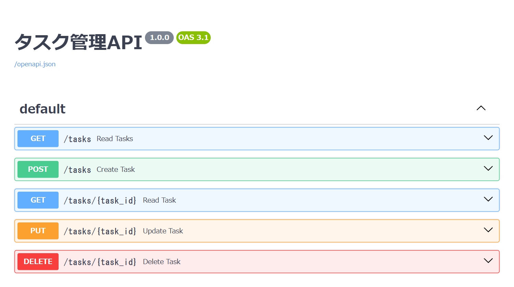

# ポートフォリオ

## 概要
FastAPI + SQLAlchemy + SQLite で実装したタスク管理 REST API です。  
ZennのWEB書籍を執筆するために制作しました。  
アプリ名：TaskAPI  
WEB書籍：[FastAPI入門 - タスク管理APIを作ってみよう!](https://zenn.dev/eguchi244_dev/books/fastapi-task-tutorial-eguchi244)



## 制作経緯
本アプリとWEB書籍は、Python で Web API を作る基本（ルーティング・入力チェック・データベース操作）を学ぶチュートリアル教材として活用したいという気持ちから制作しました。

制作にあたっては下記の項目を

* 画面を作らず、FastAPI が自動で用意する Swagger UI だけで動作を確かめられる
* Pydantic のモデルで入力と出力の形を宣言し、不正な入力を自動で 422 にする
* 「存在しない」を 404 で返すなど、HTTP のステータスコードで結果を伝える
* まず Python のリストで API を完成させ、最後にデータベースへ差し替える（URL と返す形は変えない）
* `Depends` でデータベースのセッションを受け渡し、開け閉めを1か所にまとめる

満たす体験を実現するようにしました。

## 要件&仕様
本アプリは下記の

* タスクの一覧（`?completed=true/false` で絞り込み）・1件取得・作成・更新・削除の5本のエンドポイントを持つ
* 作成時の `title` は必須・1〜255文字。違反したときは 422 を返す
* 更新は送られた項目だけを書き換える部分更新とする
* 存在しない ID へのアクセスは 404 を返す
* SQLite に保存し、サーバーを再起動してもデータが残る

を要件とする簡易なAPIです。

## システム構成
【技術スタック】
* Python 3.10+
* FastAPI, Uvicorn, Pydantic v2
* SQLAlchemy
* SQLite

【ディレクトリ構成】
```
FastAPI-Task-Tutorial-PJ（ルートディレクトリ）
├── main.py            # FastAPI アプリ（データベースの設定・モデル・エンドポイント）
├── requirements.txt   # 使うライブラリ
├── img                # README の画面
└── README.md
```

## WEB書籍の章とブランチ
WEB書籍の各章の末尾にある「ここまでのソースコード」は、下記のブランチを指しています。答え合わせにご活用ください。

| 章 | ブランチ | 内容 |
|---|---|---|
| [入門03 - 最小のFastAPIとSwagger UI](https://zenn.dev/eguchi244_dev/books/fastapi-task-tutorial-eguchi244/viewer/fastapi-task-first-app) | `Chapter03/最小のFastAPIとSwaggerUI` | 入門03を終えた時点のコード |
| [入門04 - インメモリでCRUDを作る](https://zenn.dev/eguchi244_dev/books/fastapi-task-tutorial-eguchi244/viewer/fastapi-task-in-memory-crud) | `Chapter04/インメモリでCRUDを作る` | 入門04を終えた時点のコード |
| [入門05 - バリデーションと部分更新](https://zenn.dev/eguchi244_dev/books/fastapi-task-tutorial-eguchi244/viewer/fastapi-task-validation) | `Chapter05/バリデーションと部分更新` | 入門05を終えた時点のコード |
| [入門06 - SQLiteとSQLAlchemyへ切り替える](https://zenn.dev/eguchi244_dev/books/fastapi-task-tutorial-eguchi244/viewer/fastapi-task-sqlite) | `Chapter06/SQLiteとSQLAlchemyへ切り替える` | 入門06を終えた時点のコード（完成版と同じ） |
| ― | `main` | 完成版 |

## 前提条件
PCに下記がインストールされていること。

* Python 3.10 以上
* Git（ZIP でダウンロードする場合は不要）
* モダンブラウザ（Swagger UI での動作確認に使う）

## 環境構築
Github から TaskAPI をローカル環境に構築する手順です。  
任意の作業フォルダ内で下記を実施してください（PowerShell の例）。

1. GitHubよりプロジェクトをダウンロードする
```
$ git clone https://github.com/eguchi244/FastAPI-Task-Tutorial-PJ.git
$ cd FastAPI-Task-Tutorial-PJ
```
2. 章の途中のコードを見たい場合は、ブランチを切り替える（任意）
```
$ git switch Chapter03/最小のFastAPIとSwaggerUI
```
3. 仮想環境を作り、ライブラリをインストールする
```
$ python -m venv venv
$ .\venv\Scripts\Activate.ps1
$ python -m pip install -r requirements.txt
```

## 動作確認
1. サーバーを起動する
```
$ uvicorn main:app --reload
```
2. Swagger UI を開く  
ブラウザで `http://localhost:8000/docs` を開くと、5本のエンドポイントが並びます。各エンドポイントを開いて「Try it out」→「Execute」で実際に呼び出せます。
3. タスクを作成・取得する  
`POST /tasks` に `{"title": "買い物"}` を送ると 201 でタスクが返り、`GET /tasks` の一覧に含まれます。サーバーを止めて（`Ctrl + C`）起動し直しても、タスクは残っています（初期状態に戻すときは `tasks.db` を削除します）。
